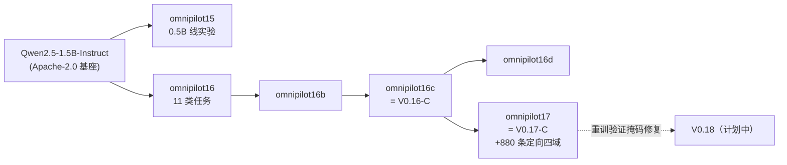

# KLJyouth-office-Modle

[](https://github.com/KLJyouth1/KLJyouth-office-Modle/releases/tag/v0.17-C)
[](https://huggingface.co/Qwen/Qwen2.5-1.5B-Instruct)
[](LICENSE)
[-8957e5)](#-技术要点)
[](#-低运行环境优先)

**Marguerite 工作台的配套本地决策模型**：权重、训练代码、训练数据、评测集、LoRA 适配器与**可复现能力图**。

它不是"什么都会聊"的通用助手，而是专注于把五件事做稳：
**选哪个工具域 → 选哪个工具 → 判是非 → 打分 → 该不该弃答**（Jev 式 Choice / Noul / Score）。

| 仓库 | 内容 |
|---|---|
| 📦 **本仓库** | 模型权重、训练代码、训练数据、评测集与能力图 |
| 🖥️ [Marguerite](https://github.com/KLJyouth1/Marguerite) | 工作台源码（Rust 引擎 + TUI + Tauri 桌面 + Web 控制台） |
| ⬇️ [Marguerite-Releases](https://github.com/KLJyouth1/Marguerite-Releases) | 安装包（WiX MSI / NSIS setup.exe） |

---

## 📑 目录

- [当前版本 · V0.17-C](#-当前版本--v017-c)
- [模型家族与血缘](#-模型家族与血缘)
- [同口径评测](#-同口径评测)
- [能力细节（逐能力图）](#-能力细节逐能力图)
- [训练数据覆盖](#-训练数据覆盖)
- [权重下载](#-权重下载)
- [快速使用](#-快速使用)
- [仓库结构](#-仓库结构)
- [已知缺陷与限制](#-已知缺陷与限制必读)
- [如何复现](#-如何复现)
- [许可与数据来源](#-许可与数据来源)

---

## 🚀 当前版本 · V0.17-C

| 项 | 值 |
|---|---|
| 命名 | `KLJyouth-office-V0.17-C` |
| 基座 | `Qwen2.5-1.5B-Instruct`（Apache-2.0，32k 上下文） |
| 微调 | **4-bit QLoRA** + LoRA（`r=16 / alpha=32`，可训练参数 4,358,144 = 0.2815%） |
| 训练样本 | **4,327**（另 227 验证），2 epochs，种子 `20261017` |
| 训练 loss | **0.0424**（V0.16-C 为 0.1019） |
| 硬件 | RTX 3050 Ti Laptop **4GB VRAM** ｜ 1,082 步 ｜ 1h47m37s |
| 发布产物 | 适配器 16.7 MB ｜ q4_K_M GGUF 940.4 MB ｜ f16 GGUF 分卷 2 卷 ｜ [Releases](https://github.com/KLJyouth1/KLJyouth-office-Modle/releases/tag/v0.17-C) |
| 实测 | 宏平均 **0.3936** ｜ 均衡宏平均 0.3636 ｜ 字母合规率 1.0000 |

### 版本摘要（**含不利结论，不美化**）

- ✅ 训练确实有效：三个微调模型的宏平均（0.377~0.394）**显著高于未微调基座**（0.306）。
- ⚠️ **本版与 V0.16-C 基本持平**（0.3936 vs 0.3766），与 16d 打平（0.3937）。
- ❌ **本轮新增的 880 条定向数据没有带来预期的路由增益**：`directed_routing` 只有 0.178
  （六选一随机 = 0.167），而**从未用这批数据训练过的 16c 是 0.224**。
- ❌ **多项任务低于随机**（`nli_score` 0.087、`nli_mnli` 0.143），且**未微调基座反而更好**。
  根因已定位并修复代码：训练样本的标签掩码起点**错位一个助手头**；但**本版适配器仍是修复前训练的**，
  收益需重训（V0.18）验证。详见 [工程日志](docs/工程日志-训练与根因.md)。

> 一句话：**这一版主要价值是把"决策基线 + 可复现评测 + 根因"打牢，而不是刷分。**

> **只有这 4 个模型有同口径测评。** 早期适配器（`omnipilot15 / 15b / 16 / 16b / sft`）**没有测评数据**——
> 它们要么是不同基座规模（0.5B 线），要么从未在当前评测台上跑过。
> **没有数据就不给数字**，不估算、不推测。

---

## 🧬 模型家族与血缘



每个版本的适配器都在 `data/adapters/<name>/`，含 `train_stats.json`（样本数 / epochs / loss），
**可从固定种子复现**。

---

## 📊 同口径评测

> 关键前提：**同一批评测集、同一提示渲染、同一次跑完**。
> 评测集文件改过之后，旧报告**不能**与新结果直接比 —— 本表是全模型重跑的结果。
> 原始数据：[`docs/eval/omnipilot17-eval-report.json`](docs/eval/omnipilot17-eval-report.json)；
> 完整分析：[评测报告](docs/评测报告-V0.17.md)。

| 模型 | 宏平均 ↑ | 均衡宏平均 ↑ | 字母合规率 ↑ | 退化任务 |
|---|---|---|---|---|
| **omnipilot17（V0.17-C）** | 0.3936 | 0.3636 | 1.0000 | 无 |
| omnipilot16c（V0.16-C） | 0.3766 | 0.3489 | 1.0000 | 无 |
| omnipilot16d | **0.3937** | **0.3652** | 1.0000 | 无 |
| qwen2.5-1.5b（未微调基座） | 0.3060 | 0.3012 | 0.8516 | `abstain` |


| 任务 | 17 | 16c | 16d | qwen |
|---|---|---|---|---|
| `routing` 六域路由 | 0.263 | **0.294** | 0.175 | 0.175 |
| `directed_routing` 定向路由 | 0.178 | **0.224** | 0.149 | 0.178 |
| `tool_choice` 工具选择 | 0.525 | **0.592** | 0.558 | 0.200 |
| `directed_tool_choice` 定向工具选择 | 0.538 | **0.548** | 0.505 | 0.280 |
| `intent_massive` 意图 | **0.492** | 0.392 | 0.308 | 0.292 |
| `intent_clinc` 意图（含域外） | 0.350 | 0.270 | 0.320 | **0.420** |
| `emotion6` 情绪 6 类 | **0.433** | 0.350 | 0.358 | 0.375 |
| `emotion28` 情绪 28 类 | 0.600 | 0.575 | **0.600** | 0.287 |
| `fact_vitaminc` 事实核验 | 0.439 | 0.421 | **0.474** | 0.316 |
| `fact_evidence_noul` 证据是否足够 | 0.508 | 0.524 | **0.635** | 0.492 |
| `nli_mnli` 蕴涵关系 | 0.143 | 0.057 | 0.057 | **0.229** |
| `nli_score` 支持程度 | 0.087 | 0.062 | 0.125 | **0.338** |
| `nli_noul` 是否蕴含 | 0.700 | **0.740** | 0.540 | **0.760** |
| `abstain` 无据拒答 | **0.550** | 0.500 | 0.500 | 0.000 |
| `grounded` 有据作答 | 0.100 | 0.100 | **0.600** | 0.250 |

---

## 🎯 能力细节（逐能力图）

每张图的竖线是该任务的**随机基线**，**红色条 = 低于随机**（意味着"被教反"而不是"没学会"，必须暴露）。

| omnipilot17（V0.17-C） | omnipilot16c（V0.16-C） |
|---|---|
|  |  |
| **omnipilot16d** | **qwen2.5-1.5b（未微调，对照组）** |
|  |  |

### 六域路由能力雷达（逐域召回，不是单一准确率）


**这张图信息量最大**：`omnipilot17` 与 `16c` 的 `browser` 召回≈1.0，而**其余五域≈0**。
即"带网址的任务能认对，其他域基本靠猜"——这解释了 `directed_routing` 为何只有 0.178：
准确率几乎全部来自 browser 那 1/6 的样本。

### 域内工具选择（逐域，含样本量）


⚠️ `blender`（n≈4）与 `code`（n≈7）的样本量过小，**这几根柱子的结论仅供方向参考，不能当结论用**。

---

## 🗂️ 训练数据覆盖

15 个任务族，共 **4,554 对样本**（训练 4,327 + 验证 227），评测集 1,460 条。

| 任务族 | 来源 | 训练 / 评测 |
|---|---|---|
| `routing` 六域路由 | 本项目 demo 轨迹 | 412 / 160 |
| `tool_choice` 域内工具 | 本项目 demo 轨迹 | 370 / 120 |
| **`directed_routing` 定向六域** | **本轮新增**（六域各 100 条，句式与线上路由同构） | **379 / 107** |
| **`directed_tool_choice` 定向工具** | **本轮新增**（覆盖 45 个真实工具） | **361 / 93** |
| `intent_massive` | MASSIVE | 437 / 120 |
| `intent_clinc` | CLINC150（含域外 OOS） | 355 / 100 |
| `emotion6` / `emotion28` | dair-ai/emotion / GoEmotions | 433 / 120、282 / 80 |
| `fact_vitaminc` / `fact_evidence_noul` | VitaminC | 225 / 57、210 / 63 |
| `nli_mnli` / `nli_noul` / `nli_score` | MNLI | 260 / 70、169 / 50、289 / 80 |
| `abstain`（无据拒答） | 合成（主体×数值扩容） | 74 / 20 |
| `grounded`（有据作答） | 合成（同上） | 71 / 20 |

**数据质量措施（实测）**：训练集与评测集**文本重叠 = 0**；每条模板必带随机占位符（防去重塌陷）；
`abstain` 与 `grounded` **共用同一条指令**（不给措辞捷径，只能读证据）。

---

## ⬇️ 权重下载

全部在 [Releases](https://github.com/KLJyouth1/KLJyouth-office-Modle/releases)。

| 版本 | 资产 | 说明 |
|---|---|---|
| [`v0.17-C`](https://github.com/KLJyouth1/KLJyouth-office-Modle/releases/tag/v0.17-C)（最新） | `...-adapter.safetensors` (16.7 MB)、`...-train_stats.json`、`...-q4_K_M.gguf` (940.4 MB)、`...-f16.gguf.part1/part2` (2000 / 950.4 MB)、**`...-merged-f16.safetensors.part1/part2` (2000 / 944.4 MB)**、**`...-merged-config.zip` (2 MB)**、`SHA256SUMS.txt` | 本版。适配器 / 可直接运行的 q4 / f16 全精度（GGUF 与 safetensors 两种容器）/ 合并权重加载所需的 config 与分词器 |
| [`v0.16-C`](https://github.com/KLJyouth1/KLJyouth-office-Modle/releases/tag/v0.16-C) | 12 个资产（约 11 GB） | 上一发布版本 |
| `legacy-*`（同前一个 release） | `legacy-0.5B-f16.*`、`legacy-1.5B.7z.001/.002` 等 | 早期 0.5B / 1.5B 线，命名保留可追溯 |

> GitHub 单资产上限 **2 GiB**，故 3.1 GB / 2.9 GB 的大权重以 2 卷发布。合并**不需要装 7-Zip**：
> ```cmd
> copy /b KLJyouth-office-V0.17-C-f16.gguf.part1+KLJyouth-office-V0.17-C-f16.gguf.part2 KLJyouth-office-V0.17-C-f16.gguf
> copy /b KLJyouth-office-V0.17-C-merged-f16.safetensors.part1+KLJyouth-office-V0.17-C-merged-f16.safetensors.part2 KLJyouth-office-V0.17-C-merged-f16.safetensors
> ```
> 每个资产都在 `SHA256SUMS.txt` 里。
>
> **merged safetensors 怎么用**：合卷得到 `model.safetensors` 后，把 `...-merged-config.zip` 解压到**同一目录**
> （含 `config.json` / `generation_config.json` / `tokenizer.json` / `tokenizer_config.json` / `chat_template.jinja`），
> 即可直接被 `transformers` / `llama.cpp` 的转换器加载。若只想复现效果而不下载 2.9 GB，
> 用 16.7 MB 的适配器 + 公开基座合并即可（见「方式三」）。

---

## ⚡ 快速使用

### 方式一：Marguerite 工作台（最省事）

装 [Marguerite](https://github.com/KLJyouth1/Marguerite-Releases) → 「设置 → 模型」新增本地档案，
`base_url = http://127.0.0.1:11434`（Ollama 端点），模型名填你注册的 GGUF 模型名。
若希望它参与某档位回退，需把该档案 id 加入工作台 `tier_rules.json` 的对应档链。

### 方式二：直接跑 GGUF

```powershell
ollama create KLJyouth-office-V0.17-C -f .\Modelfile   # FROM 指向 q4_K_M.gguf
ollama run  KLJyouth-office-V0.17-C
```

### 方式三：从适配器复现（最轻量）

```powershell
# base     = Qwen2.5-1.5B-Instruct
# adapter  = data/adapters/omnipilot17
# merge_lora() → build_gguf() → register_ollama()  （都在 train/merge.py 里）
```

> **两个必须知道的坑（实测）**
> 1. **先转 GGUF 再量化**。直接从 safetensors 目录量化（Ollama 0.15.2 实测）会产出**崩溃模型**。
> 2. 决策模型注册务必 **`--no-system --temperature 0`**。训练样本是「单条 user(决策提示) → 字母」，
>    注入 SYSTEM 会让推理分布与训练不一致、字母概率失真。

---

## 📁 仓库结构

```
train/              训练代码（qlora.py 的 QLoRA 训练 / decision_data.py 的数据管线 / merge.py 导出）
eval/               评测台（decision_eval.py，Jev 三接口同口径打分）
decision/           Jev 式决策契约与引擎（schema / engine / experts / active）
agent/ tools/       工具域路由与工具层
data/datasets/      训练/验证/评测数据（含 decision_eval/ 的 15 个任务文件）
data/adapters/      LoRA 适配器：15 / 15b / 16 / 16b / 16c / 16d / 17 / sft
  omnipilot17/      ← 即 KLJyouth-office-V0.17-C（adapter + tokenizer + chat_template + train_stats）
data/demos/         自演示范轨迹
docs/               评测报告 / 工程日志与根因 / 架构与思路 / 工作记录 / 发布说明
docs/charts/        能力图（由脚本从评测报告生成）
docs/eval/          评测原始报告 JSON
scripts/            make_capability_charts.py（可从报告一键复现全部图表）
tests/              单元测试
```

> **不纳入本仓库**：`**/ckpt/**/optimizer.pt`（每份 33.4 MB，可由 `train_stats.json` + 固定种子复现）、
> `__pycache__`、以及**原始对话记录**（含明文令牌与隐私，故改用 `docs/本次工作记录.md` 脱敏等价记录）。

---

## ⚠️ 已知缺陷与限制（必读）

| 缺陷 / 限制 | 影响 | 状态 |
|---|---|---|
| **标签掩码起点错位一个助手头** | 训练时学字母的位置与推理时读概率的位置**错开**；导致多选普跌、NLI 低于随机。**影响修复前训练的全部适配器（15/15b/16/16b/16c/16d/17）** | 代码已修，**收益待 V0.18 重训验证** |
| `nli_score` / `nli_mnli` 低于随机 | 未微调基座反而更好（0.338 / 0.229 vs 0.087 / 0.143） | **未解决**：需逐任务核对候选顺序×标准答案×判分口径 |
| `grounded` 在 17/16c 上崩塌（0.100） | 面对"材料已给出"的问题几乎都答 `false`，与 `abstain` 反向 | **未解决** |
| 定向路由只学会 browser | 六域里只有 browser 召回≈1.0，其余≈0 | **未解决**：说明只学到了表面线索（网址） |
| `directed_tool_choice` 切片过薄 | `blender` n=4、`code` n=7，逐域工具级结论不可用 | 待扩数据 |
| **4GB 显存物理边界** | 本地只能训 ≤1.5B（4-bit QLoRA）。**7B / 万亿参数 / 全模态 / 世界模型本地训练不可行**，只能"接入 + 编排" | 硬约束，不做虚假承诺 |
| `--resume` 续训 | 仅实测过 **1 次**（从 `checkpoint-400`），不足以断言普遍可靠 | 部分验证 |

---

## 🔁 如何复现

```powershell
# 1) 训练（4GB 显存可用；中途可 --resume 从检查点续训）
python -m omnipilot.cli train --base <Qwen2.5-1.5B-Instruct 本地快照> `
  --name omnipilot17 --epochs 2 --max-len 768 --grad-ckpt --use-4bit

# 2) 合并 → GGUF → 注册（一条命令）
python -m omnipilot.cli deploy --base <基座> --adapter data/adapters/omnipilot17 `
  --name omnipilot17 --no-system --temperature 0

# 3) 同口径评测（务必多模型一起跑，否则不可比）
python -m omnipilot.eval.decision_eval --models omnipilot17,omnipilot16c,omnipilot16d,qwen2.5-1.5b `
  --out omnipilot17-eval-report.json

# 4) 从报告一键出全部能力图（无网络、无模型依赖）
python scripts/make_capability_charts.py
```

---

## 🧠 类脑稀疏：我们怎么做的、边界在哪

**核心约束**：4GB 显存不可能同时驻留多个专家。所以"稀疏激活"不是"把 N 个专家一起塞进显存"，
而是**每一步只激活一个**。

**两条已实现的稀疏路径**

1. **专家路由（LoRA 专家按需装卸）** —— [`decision/experts.py`](decision/experts.py)
   - 一个专家 = 基座 + 某领域 LoRA，各自注册为**独立 Ollama 模型**；
   - 门控先用 Jev 式 Choice 选出"该交给哪个专家"，再把**只有该专家**挂到基座上推理；
   - Ollama 按 `keep_alive` 自动卸载 → 同一时刻只有一个专家进显存，这正是稀疏激活；
   - 门控复用 Choice 接口，白拿概率分布 + `letter_ok` 可信度 + 回退策略
     （门控不可信就走默认专家，**宁可保守也不误路由**）。
2. **决策候选集稀疏（prefill-only）** —— [`decision/engine.py`](decision/engine.py)
   - 候选渲染成 `A) … B) …`，只解码极少量 token，从 logprobs 直接读候选概率；
   - 不逐字生成 → **一次前向 = 一次决策**，开销取决于候选数而非答案长度。

**⚠️ 边界（不许包装成"已完成"）**

| 能力 | 代码状态 | 生产可用性 |
|---|---|---|
| 决策候选集稀疏（字母-logit） | 已实现 | ✅ **生产在用**（工作台六域路由 + 评测台） |
| 专家路由 `ExpertRouter` / `ExpertRegistry` | 已实现 + 单测覆盖 | ⚠️ **当前只有测试可达**；且 `omnipilot16-code_exp` 这类**分域专家模型尚未训练** → 现在接线只会永远走默认专家回退 |
| 主动求知 `ActiveDecider`（先查记忆 → 再上网 → 仍不可信就如实报告） | 已实现 + 单测覆盖 | ⚠️ **只有测试可达**，未接进运行时 |
| 档位/四档路由（工作台侧） | 已实现 | 需把本地档案 id 加入 `tier_rules.json` 对应档链才生效 |

> 结论：**类脑稀疏目前是"架构就绪、部分接线"**，不是"已经跑起来的能力"。
> 要真跑起来，前置是**先训出分域专家**（6 个领域各一份 LoRA），再把门控接进工作台工具循环（见下方 P2）。

---

## 🎯 我们模型的特点、优势与先进性

**最根本的差异**：不做逐字生成，而做**决策**——输出是候选上的概率分布 + 一个字母，
让上层能直接做阈值、熔断与回退。

| 维度 | 我们的做法 | 为什么是优势 |
|---|---|---|
| 决策形态 | Jev 式 Choice / Noul / Score，**prefill-only 一次前向**给出候选分布 | 省掉解码等待；上层拿到的是**概率**而非文本，可直接用于决策与回退 |
| 诚实性 | 内置 `letter_ok` 诊断：模型没按字母作答时**明确报 False** | 概率不可信时上层能回退，避免"自信地给错答案"——这是同类小模型通常缺失的 |
| 抗幻觉 | `abstain` 与 `grounded` **共用同一条指令**，证据内联在 state 里 | 不给措辞捷径，模型只能真去读"有没有证据" |
| 运行环境 | q4_K_M **940 MB 可 100% 进 4GB 显存**；LoRA 仅 16.7 MB 可热插拔 | 真正的低配可用，不是"能跑但很慢" |
| 契约化 | Choice / Noul / Score 三接口字段与官方 `example_request.json` **逐字对齐** | 换后端（云 / 本地）不需要改上层代码 |
| 可复现 | 固定种子 + 数据与统计随仓 + 图表可从报告一键复现 | 结论可被复核，不靠"我记得" |
| 稀疏友好 | 专家按需装卸 + 候选集稀疏 | 4GB 卡上**可行**的稀疏形态 |

**先进性：必须把"架构"与"分数"分开说**

- ✅ **架构层面已兑现**：字母-logit 直取概率、内置诚实度信号、三接口契约、量化到"能进 4GB 显存"的交付、
  可复现评测与能力图。**同规模（0.5B~1.5B）的公开模型里少见**——它们通常只做聊天补全，
  不提供决策概率与可信度诊断。
- ⚠️ **能力层面尚未兑现**：本版宏平均 **0.3936**，且 `nli_score` 0.087、`nli_mnli` 0.143、`grounded` 0.100
  **低于随机**，定向路由**只学会了 browser 一域**。
  → **"先进性"目前是设计与工程上的，不是分数上的。**
- ❌ **不做虚假承诺**：7B / 万亿参数 / 全模态 / 世界模型在 4GB 上本地训练**物理不可行**；
  这类能力只能以"接入 + 编排"获得，**不计入本仓库的训练成果**。

---

## 🔭 未来方向与计划

### P0 · V0.18：重训验证「标签掩码修复」（当前最高优先级）

- **唯一目的**：验证 [根因①](docs/工程日志-训练与根因.md) 的修复是否真的提升字母概率质量。
- **做法**：超参**完全不变**（`lr=2e-4`、`r=16/alpha=32`、`batch=1×accum=8`、`max_len=768`、
  `gradient_checkpointing`、4-bit QLoRA、2 epochs、同种子），**只改** `train/qlora.py` 的标签掩码起点
  → 重训 → 与 V0.17 **同口径**评测。
- **验收标准（先写死，避免事后解释）**：`nli_score` / `nli_mnli` **回到或超过随机**，
  且宏平均**显著高于 0.3936**；否则判定修复无效，继续找根因，**不做"看起来变好了"的叙事**。
- **代价**：约 1.5 小时占满显卡（实测 9~14 s/it，4GB 卡）。

### P1 · 修掉另外三个已定位缺陷

1. **NLI 低于随机**：逐任务核对「候选渲染顺序 × 标准答案字母 × `answer_is_correct` 判分口径」
   三者是否真的一致（历史上出现过两任务候选顺序相反、正确答案字母互换的坑）。
2. **`grounded` 崩塌**：让 `abstain` / `grounded` 真正只能靠 state 里**有没有证据**区分。
3. **定向路由只学会 browser**：定向数据补入"同域多表述"（不含网址、不含域名词的句子），
   逼模型学语义而不是抓"有网址 → 浏览器"这个捷径。

### P2 · 稀疏与蒸馏（两条主线）

- **分域专家训练**：`code / office / browser / media / blender / system` 六个领域各训一份 LoRA，
  再把 `ExpertRouter` 接进工作台工具循环 —— 这才让"类脑稀疏"从**架构就绪**变成**真的跑起来**。
- **教师软标签蒸馏**：用本地更强的老师模型（如 `qwen3:4b`）产出**经过验证**的软标签
  （工具名必须在真实清单内、必填参数齐全、数值必须来自工具输出），**未通过验证的一律丢弃** ——
  从源头降低幻觉，而不是事后补丁。

### P3 · 接入工作台四档路由

- 把本模型注册为**本地档案**（`kind=local`、`base_url=http://127.0.0.1:11434`），
  按实测能力放进合适档位链（本地小模型因上下文与单价特征，天然落**极速档**）；
- 工作台侧的**档位治理已接通**（档内候选必须过准入线、凭证与主客户端同源解析、缺密钥的云候选剔除），
  本地档案一旦入链即可参与回退。

### P4 · 数据与评测的下一轮

- **扩容薄切片**：`directed_tool_choice` 的 `blender`(n=4) / `code`(n=7) 必须先补到每域 ≥40，
  否则"逐域工具能力"的结论没有统计意义；
- **评测集冻结版本号**：避免重演"评测集被改 → 旧报告不可比"（本轮已真实发生过一次，
  当时的旧报告与今天结果直接冲突）。

### 长期 · 明确不做的事

- 不在 4GB 上训练 >1.5B；
- 不把"接入云端大模型"包装成自研成果；
- **不发布没有同口径测评数字的版本**。

---

## 📄 许可与数据来源

基座 **Qwen2.5-1.5B-Instruct** 为 Apache-2.0；本仓库训练代码、数据与适配器沿用同一许可。

训练数据派生自 **MASSIVE / CLINC150 / GoEmotions / MNLI / VitaminC** 等公开数据集。
**分发或商用前请自行核对各数据集的原始许可。**
