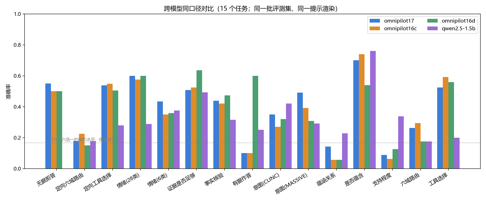
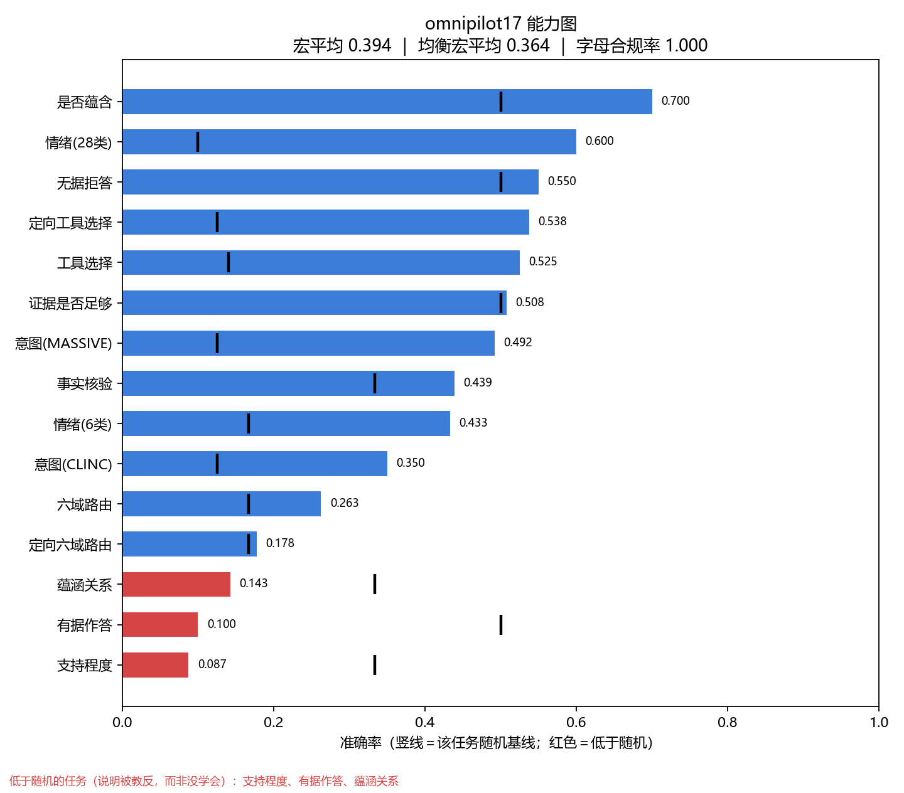
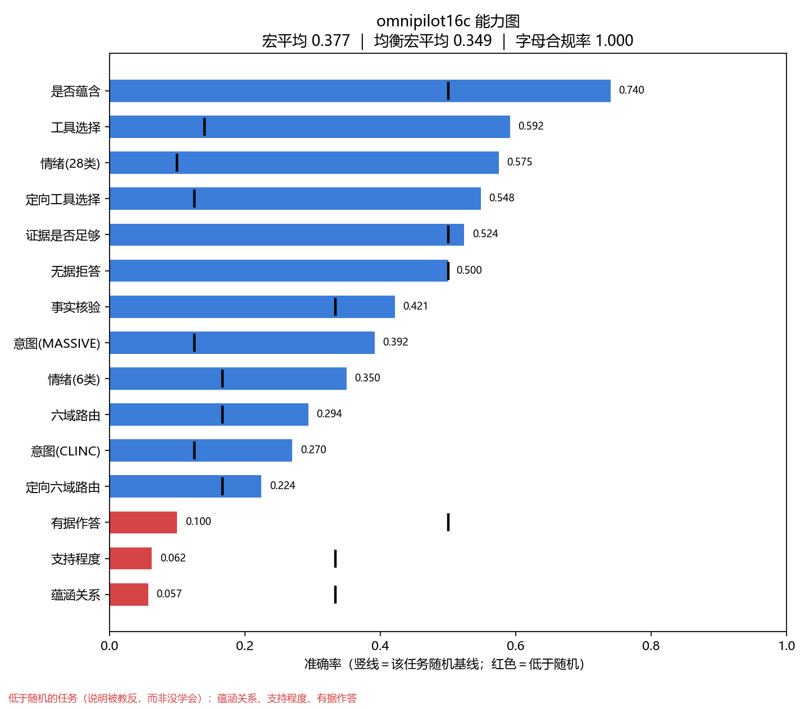
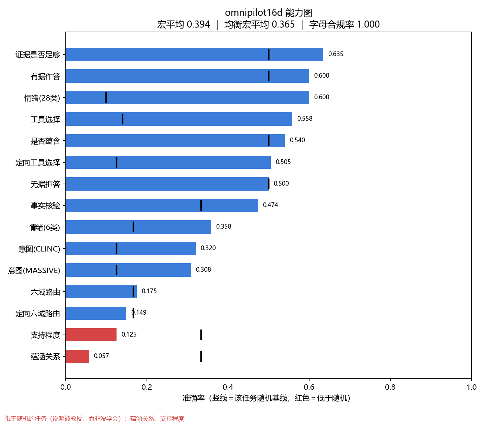
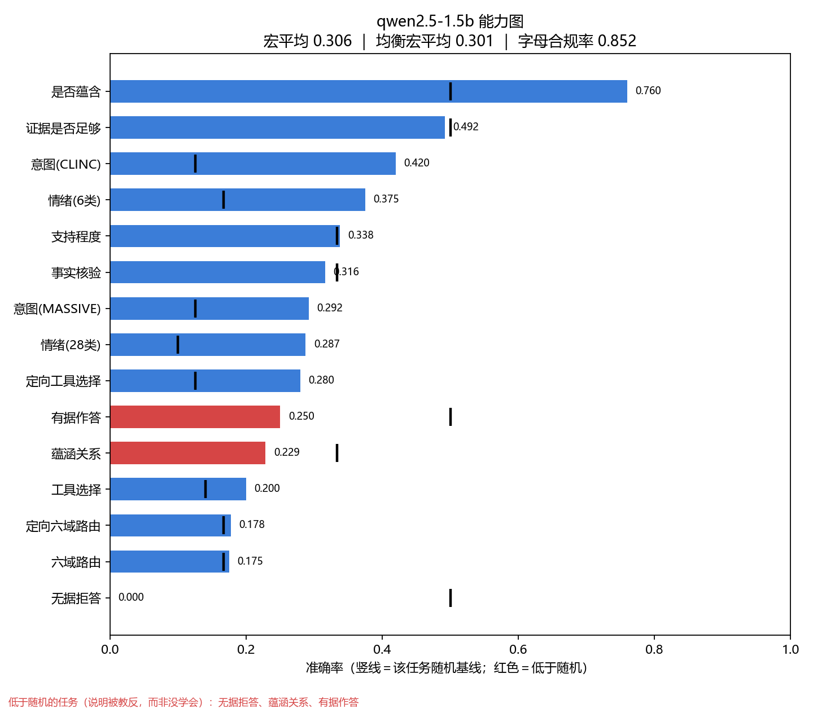
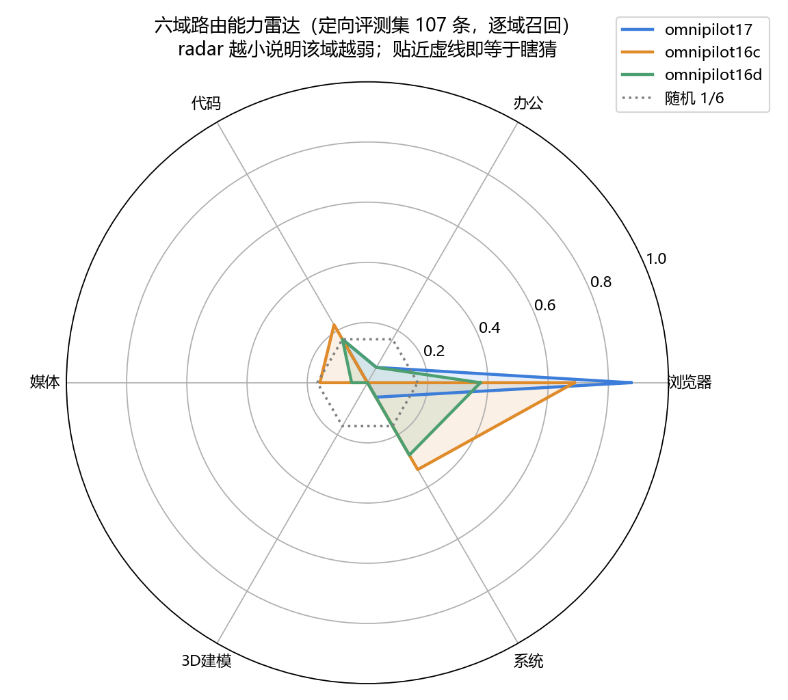
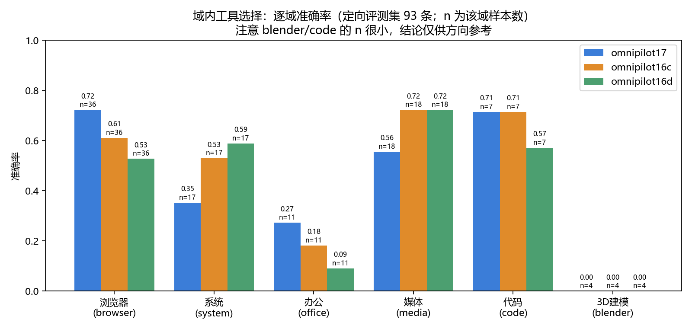

# 模型评测报告 · KLJyouth-office-V0.17-C

> 本报告的全部数字来自**同一次**评测：同一批评测集、同一提示渲染、同一解码参数（`temperature=0`、`num_predict=2`）。
> 原始数据见 [`omnipilot17-eval-report.json`](omnipilot17-eval-report.json)，图表由 [`scripts/make_capability_charts.py`](../../scripts/make_capability_charts.py) 从此报告复现。

## 1. 评测方法

| 项 | 设置 |
|---|---|
| 评测台 | [`eval/decision_eval.py`](../../eval/decision_eval.py)（Jev 式 Choice / Noul / Score 契约） |
| 提示渲染 | `decision/engine.py::build_prompt` —— 与**训练样本逐字同构**（State / Question / Options / 只答字母） |
| 打分口径 | `choice` 取字母对应候选；`noul` 以 0.5 阈值判是非；`score` 取概率 argmax 等级精确匹配 |
| 字母合规率 `letter_ok` | 模型首个生成 token **本身是候选字母**的比例。它低说明概率不可信、上层必须回退 |
| 均衡宏平均 | 各任务**逐类召回**等权平均。它才能识别"恒答多数类"的退化策略；普通宏平均会被多数类抬高 |

### 参评模型

| 名称 | 说明 | 训练数据 |
|---|---|---|
| `omnipilot17` | 本次发布的 V0.17-C（基于 V0.16-C 数据 + 880 条定向样本） | 4,327 条，2 epochs |
| `omnipilot16c` | V0.16-C（上一发布版本） | 3,781 条，2 epochs |
| `omnipilot16d` | V0.16-D（16c 之后的实验变体） | 见 `data/adapters/omnipilot16d/train_stats.json` |
| `qwen2.5-1.5b` | **未微调基座**，作为对照 | — |

## 2. 总榜

| 模型 | 宏平均 ↑ | 均衡宏平均 ↑ | 字母合规率 ↑ | 退化任务 |
|---|---|---|---|---|
| **omnipilot17** | 0.3936 | 0.3636 | 1.0000 | 无 |
| omnipilot16c | 0.3766 | 0.3489 | 1.0000 | 无 |
| omnipilot16d | **0.3937** | **0.3652** | 1.0000 | 无 |
| qwen2.5-1.5b（未微调） | 0.3060 | 0.3012 | 0.8516 | `abstain` |



## 3. 逐任务准确率

| 任务 | 17 | 16c | 16d | qwen（未微调） |
|---|---|---|---|---|
| `routing` 六域路由 | 0.263 | **0.294** | 0.175 | 0.175 |
| `directed_routing` 定向六域路由 | 0.178 | **0.224** | 0.149 | 0.178 |
| `directed_tool_choice` 定向工具选择 | 0.538 | **0.548** | 0.505 | 0.280 |
| `tool_choice` 工具选择 | 0.525 | **0.592** | 0.558 | 0.200 |
| `intent_massive` 意图 | **0.492** | 0.392 | 0.308 | 0.292 |
| `intent_clinc` 意图（含域外） | 0.350 | 0.270 | 0.320 | **0.420** |
| `emotion6` 情绪 6 类 | **0.433** | 0.350 | 0.358 | 0.375 |
| `emotion28` 情绪 28 类 | 0.600 | 0.575 | **0.600** | 0.287 |
| `fact_vitaminc` 事实核验 | 0.439 | 0.421 | **0.474** | 0.316 |
| `fact_evidence_noul` 证据是否足够 | 0.508 | 0.524 | **0.635** | 0.492 |
| `nli_mnli` 蕴涵关系 | 0.143 | 0.057 | 0.057 | **0.229** |
| `nli_score` 支持程度 | 0.087 | 0.062 | 0.125 | **0.338** |
| `nli_noul` 是否蕴含 | 0.700 | **0.740** | 0.540 | **0.760** |
| `abstain` 无据拒答 | **0.550** | 0.500 | 0.500 | 0.000 |
| `grounded` 有据作答 | 0.100 | 0.100 | **0.600** | 0.250 |

## 4. 能力图（逐模型）

| omnipilot17 | omnipilot16c |
|---|---|
|  |  |
| **omnipilot16d** | **qwen2.5-1.5b（未微调）** |
|  |  |

图上竖线＝该任务随机基线（1/候选数）；**红条＝低于随机**。

### 六域路由能力雷达（定向评测集，逐域召回）



**这张图是本报告里信息量最大的一张**：`omnipilot17` 与 `omnipilot16c` 的 **browser 召回≈1.0，其余五域≈0**。
即"带网址/链接的任务能认对，其他域基本靠猜"。这解释了 `directed_routing` 只有 0.178（六选一随机 0.167）：
准确率几乎全部来自 browser 那 1/6 的样本。

### 域内工具选择（逐域）



`blender`/`code` 的样本数很小（n≈4~7），**这几根柱子的结论仅供方向参考，不能当结论用**。

## 5. 结论（含对本轮实验的负面结论）

1. **训练确实有效**：三个微调模型的宏平均（0.377~0.394）显著高于未微调基座（0.306），且字母合规率 1.0 vs 基座 0.85。
2. **本轮新增的 880 条定向数据没有带来预期的路由增益**——这是负结果：
   - `directed_routing`：V0.17 = 0.178，而**从未用这批数据训练过的 16c = 0.224**；
   - 生产真正消费的 `routing`：V0.17 = 0.263 < 16c = 0.294；
   - V0.17 与 16d 在宏平均上打平（0.3936 vs 0.3937）。
3. **多项任务低于随机，且未微调基座反而更好**（`nli_score` 0.087 vs 0.338、`nli_mnli` 0.143 vs 0.229）。
   低于随机不是"没学会"，而是**被教反了**。根因已定位并修复，见
   [工程日志 · 根因分析](工程日志-训练与根因.md#根因标签掩码起点错位一个助手头)，
   但**已发布的所有适配器都是在修复前训练的**，需重训才能验证。
4. `grounded` 在 17/16c 上崩到 0.100（16d = 0.600），是另一个仍未解决的数据缺陷。

## 6. 如何复现

```powershell
# 1) 注册模型（先确保 Ollama 守护进程在跑）
ollama list
# 2) 同口径评测（--out 落报告）
python -m omnipilot.eval.decision_eval `
  --models omnipilot17,omnipilot16c,omnipilot16d,qwen2.5-1.5b `
  --out omnipilot17-eval-report.json
# 3) 出图（无网络、无模型依赖）
python scripts/make_capability_charts.py
```

> `decision_eval.py` 把 `data/datasets/decision_eval/*.jsonl` 全部当任务集，**新增一个评测文件就等于新增一个任务**，
> 所以跨版本对比必须用**同一批文件**重跑，不能拿旧报告直接比。
